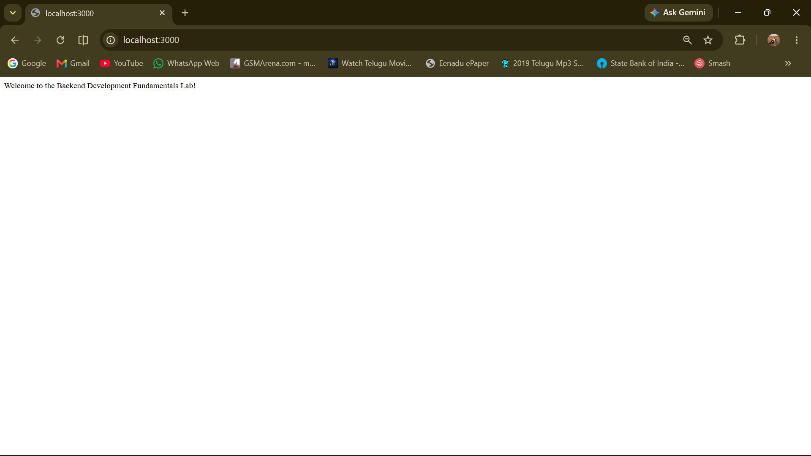
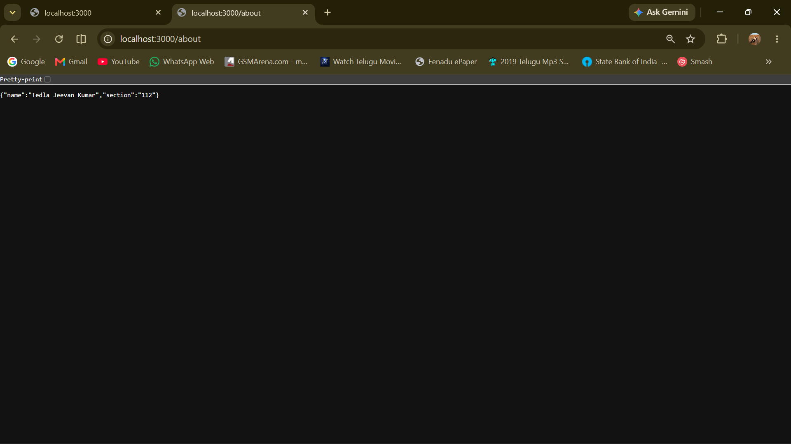
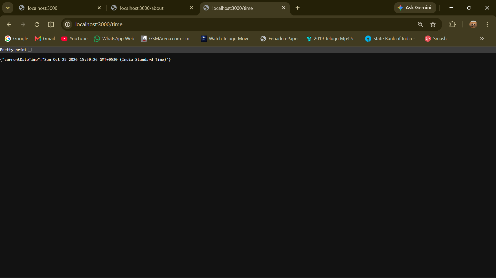
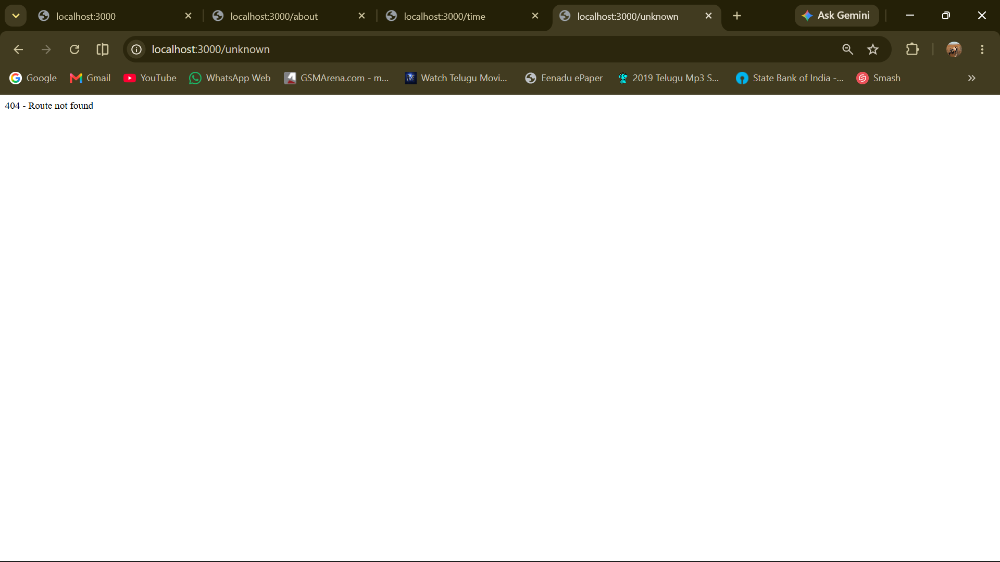

# Lab 1: Node.js and Express Server

## Student Details

- **Name:** Tedla Jeevan Kumar
- **Registration Number:** 252U1R9159
- **Section:** CSE GEN AI 2C / 112
- **Lab Number:** 01
- **Lab Title:** Node.js and Express Server

## Objective

To understand the fundamentals of backend development using Node.js and Express.js by creating an HTTP server, handling client requests, defining routes, returning responses, and managing invalid routes.

## Technologies Used

- **Node.js** — JavaScript runtime for server-side development.
- **Express.js** — Framework for building web servers and APIs.
- **Visual Studio Code** — Code editor.
- **Git and GitHub** — Version control and source code hosting.
- **Render** — Cloud deployment platform.

## Project Structure

```text
lab-01/
├── screenshots/
│   ├── home-route.png
│   ├── about-route.png
│   ├── time-route.png
│   └── not-found.png
├── .gitignore
├── http-server.js
├── package.json
├── package-lock.json
├── README.md
└── server.js
```

The `node_modules/` directory is generated automatically when dependencies are installed and should not be committed to GitHub.

## Installation and Setup

### Prerequisites

Install [Node.js](https://nodejs.org/) and npm.

Verify the installation:

```bash
node --version
npm --version
```

### Install Dependencies

Open a terminal in the project directory and run:

```bash
npm install
```

### Start the Express Server

Run:

```bash
npm start
```

The server runs locally at:

`http://localhost:3000`

## Implementation

### 1. Basic HTTP Server

The `http-server.js` file uses Node.js's built-in `http` module to create a server that responds to HTTP requests with plain text.

### 2. Express Server

The `server.js` file uses Express.js to create an application, define GET routes, send responses, and handle requests to undefined routes.

## API Endpoints

| HTTP Method | Endpoint | Description | Expected Status |
|---|---|---|---|
| GET | `/` | Displays the welcome message | 200 OK |
| GET | `/about` | Returns student information in JSON format | 200 OK |
| GET | `/time` | Returns the current date and time in JSON format | 200 OK |
| GET | `/unknown` | Returns a not-found message | 404 Not Found |

## Screenshots

### Home Route

Displays the welcome message from the Express server.



### About Route

Displays student information in JSON format.



### Time Route

Displays the current date and time.



### Invalid Route

Displays the 404 response for an undefined route.



## Package Configuration

The `package.json` file contains project information, dependencies, and the start script:

```json
"scripts": {
  "start": "node server.js"
}
```

The server can therefore be started with `npm start`.

## Deployment

The application is intended to be deployed using Render.

- **Build Command:** `npm install`
- **Start Command:** `npm start`
- **Root Directory:** Leave blank if the application files are located directly in the repository root.

After deployment succeeds, add the public Render URL here:

**Live Application:** `https://backend-development-fundamentals.onrender.com/`

## Learning Outcomes

- Understood the basics of Node.js and Express.js.
- Created an HTTP server using Node.js.
- Implemented GET routes in Express.
- Sent plain-text and JSON responses.
- Used HTTP status codes, including 200 and 404.
- Tested server endpoints using a web browser.
- Used Git and GitHub to manage project files.
- Learned the basics of deploying a Node.js application.

## Result

A basic HTTP server was created using Node.js, and an Express.js application was developed with routes for a welcome message, student information, and the current date and time. A handler for undefined routes was also implemented to return a 404 response.
