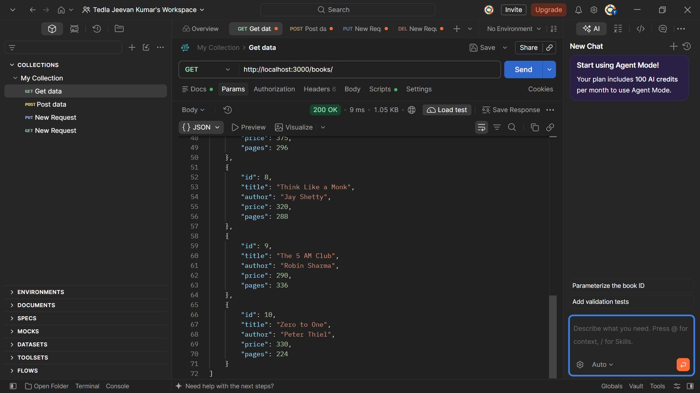
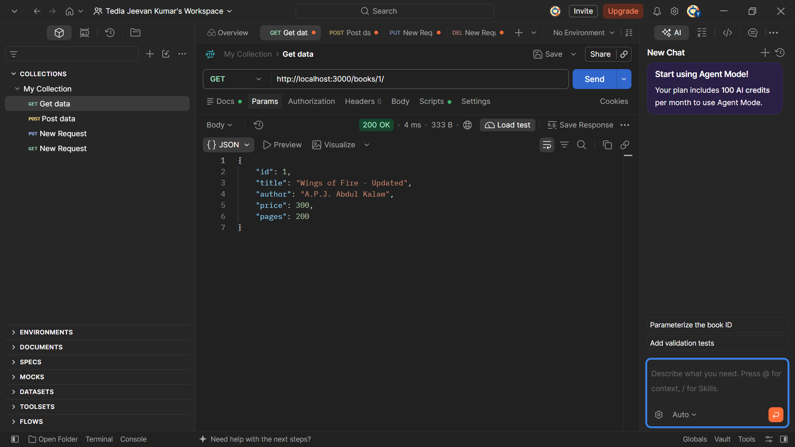
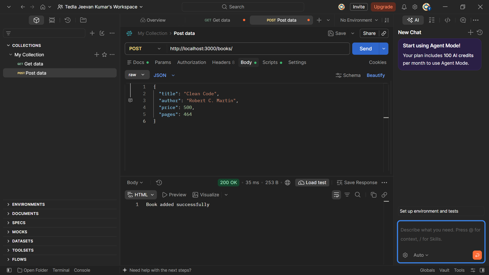
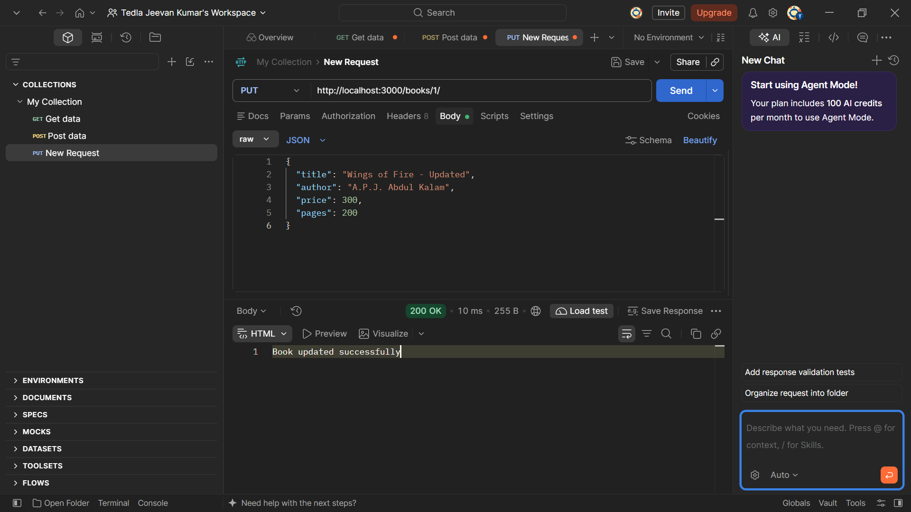
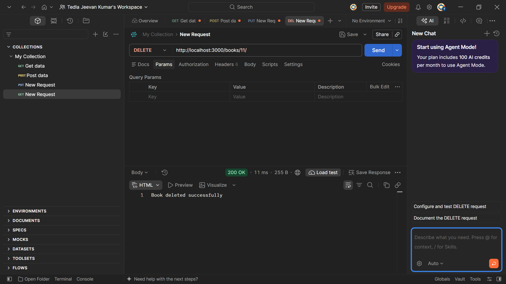

# Lab 02: SQLite Database and CRUD Routes

## Student Details

- **Name:** Tedla Jeevan Kumar
- **Registration Number:** 252U1R9159
- **Section:** CSE Gen AI 2C
- **Lab Number:** 02

## Live Deployment

**Deployment URL:** Not deployed yet.

## Objective

To connect an Express server to an SQLite database and implement CRUD (Create, Read, Update, Delete) operations using HTTP routes.

## Technologies Used

- Node.js
- Express.js
- SQLite
- sqlite3
- sqlite
- Nodemon
- Postman

## Project Structure

```text
lab-02/
├── screenshots/
│   ├── get-all-books.png
│   ├── get-single-book.png
│   ├── post-book.png
│   ├── put-book.png
│   └── delete-book.png
├── app.js
├── database.js
├── books.db
├── package.json
├── package-lock.json
└── .gitignore
```

## Installation and Setup

1. Navigate to the lab directory:

```bash
cd lab-02
```

2. Install dependencies:

```bash
npm install
```

3. Start the development server:

```bash
npm run dev
```

The server runs at:

`http://localhost:3000/`

## API Endpoints

| HTTP Method | Endpoint | Description |
|---|---|---|
| GET | `/books/` | Get all books |
| GET | `/books/:bookId/` | Get a book by ID |
| POST | `/books/` | Add a new book |
| PUT | `/books/:bookId/` | Update a book |
| DELETE | `/books/:bookId/` | Delete a book |

## Screenshots and Testing

### 1. GET All Books

Retrieves all books from the SQLite database.



### 2. GET Single Book

Retrieves a specific book using its ID.



### 3. POST - Add Book

Adds a new book to the database.



### 4. PUT - Update Book

Updates the details of an existing book.



### 5. DELETE - Remove Book

Deletes a book from the database.



## Database Details

- Database file: `books.db`
- Table name: `book`
- Columns: `id`, `title`, `author`, `price`, `pages`
- Initially inserted 10 sample book records.
- Verified database changes after POST, PUT and DELETE operations.

## Notes

- Used asynchronous database operations.
- Used parameterized SQL queries with `?` placeholders.
- Used Nodemon for automatic server restarts.
- Tested all five CRUD endpoints using Postman.
- Verified database records after performing CRUD operations.
